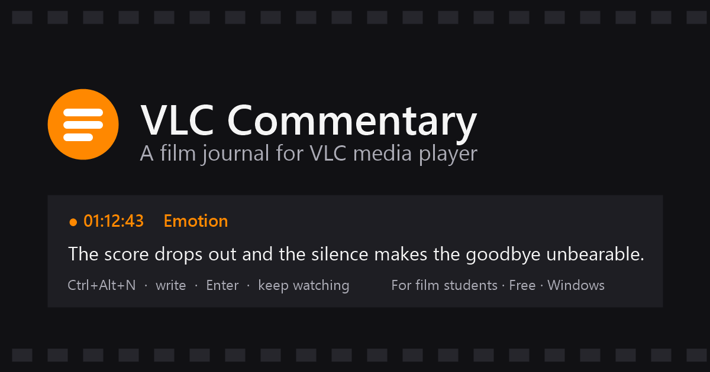

<p align="center">
  
</p>

# VLC Commentary: a film journal for VLC media player

**Take timestamped notes on scenes, emotions and ideas while you watch a movie in VLC, without leaving the film.**
Press `Ctrl+Alt+N`, write what you noticed or felt, press `Enter`. Every note is saved with the exact moment
in the movie, so later you can see what you thought and felt about each scene.

Built for **film school students**, film studies classes, critics, video essayists and anyone who keeps a film diary.
Free, for Windows 10/11.

**[⬇ Download VlcCommentarySetup.exe](../../releases/latest)** · [Website](https://nikhil-patil178.github.io/vlc-commentary/)

---

## Who it's for

- **Film school and film studies students** doing scene analysis, shot breakdowns or close readings for class.
  Write while you watch instead of pausing, rewinding and guessing the timestamp.
- **Anyone tracking their emotional response to a film.** Tag a note as *Emotion* the moment a scene hits you,
  then see where your feelings shifted across the whole movie.
- **Video essayists and YouTube film commentators** collecting timestamped material for a script.
- **Critics and reviewers** who want notes tied to exact moments, not memory.
- **Screenwriting and directing students** studying structure, pacing and character turns in films they admire.

## What it does

| | |
|---|---|
| **Notes without stopping the film** | A hotkey opens a small box in the corner over the movie. Type, press Enter, keep watching. You can optionally auto-pause while typing. |
| **Exact timestamps** | Every note gets the precise playback time from VLC, e.g. `01:12:43`. |
| **Four note types** | **Observation** (what you see), **Interpretation** (what it means), **Emotion** (what you feel), **Question** (what to look into). Tap `Tab` to switch. |
| **See what you've written** | Hold `Tab` to list your earlier notes for the film, with a marker showing where this moment fits. |
| **One folder per film** | `Documents\VLC Commentary\<Film>\` holds your notes as Markdown (readable anywhere) and JSON, plus the film's **subtitles**, so you can quote dialogue. |
| **Never mixes films up** | Each film is recognised by a fingerprint of the video file, so same-named files stay separate and renamed files keep their notes. |
| **Your thoughts are safe** | Saves go straight to disk, and an unfinished note survives a crash or power cut. |
| **Private** | Everything stays on your PC. No account, no cloud, no tracking. |

Example of a saved note file (`Taare Zameen Par.md`):

```markdown
## [00:08:35] Observation - draft
Ishaan watches the fish instead of the board. The camera stays at his eye level.

## [00:12:10] Emotion - draft
His father's voice makes me tense; the score drops out completely here.

## [00:20:10] Interpretation - draft
The beginning of learned helplessness: he stops trying to explain himself.
```

## Install

1. Download **VlcCommentarySetup.exe** from the [latest release](../../releases/latest).
2. Run it and click **Install**. If Windows SmartScreen warns about an unknown publisher (the exe isn't
   code-signed), click **More info → Run anyway**.
3. Open a film in VLC and press **Ctrl+Alt+N**.

The installer sets everything up for you, with no admin rights needed except to install VLC itself:
- installs **VLC media player** with winget if it's missing
- installs the app to `%LOCALAPPDATA%\Programs\VLC Commentary`
- backs up `%APPDATA%\vlc\vlcrc`, then turns on VLC's web interface: `127.0.0.1` only (not reachable from
  other computers), random password, first free port from 8765
- installs **FFmpeg** with winget so subtitles inside video files can be saved (optional)
- adds a Start menu shortcut, can start the app when you sign in, and registers an uninstaller in **Settings → Apps**

Running it again upgrades in place and keeps your settings and notes.

## Using it

| Key | In the note box |
|---|---|
| `Ctrl+Alt+N` | Open the note box; the timestamp is captured at this moment |
| `Enter` | Save and close |
| `Shift+Enter` | New line |
| Tap `Tab` / `Shift+Tab` | Change type: Observation, Interpretation, Emotion, Question |
| Hold `Tab` | Show the notes already saved for this film |
| `Esc` | Cancel |

- The box appears in the top-right corner, clear of subtitles. The film keeps playing. To pause while you
  type, right-click the tray icon and tick **Pause the movie while I type**.
- If you click back into the film mid-note, the box stays open with your text. Press `Ctrl+Alt+N` to return to it.
- Saving is silent. If a save ever fails, a red notice appears and your text is copied to the clipboard.

### Where your notes go

```
Documents\VLC Commentary\
  Taare Zameen Par\
    Taare Zameen Par.md         readable notes, regenerated on every save
    Taare Zameen Par.json       the same notes as data: timestamp, type, status, text
    Taare Zameen Par.eng.srt    the film's subtitles
    subtitles.txt               which subtitles were saved and from where
```

**Subtitles** are saved after your first note on a film, once, in the background at idle priority:
separate subtitle files next to the film are copied, and subtitle tracks inside `.mkv`/`.mp4` files are
extracted with FFmpeg. Delete `subtitles.txt` to make the app look again.

## FAQ

**Is there a VLC plugin or extension for taking notes while watching a movie?**
Yes, that's what this is. VLC's own extension system can't show a text box over the video or capture a global
hotkey, so VLC Commentary runs as a small companion app and talks to VLC through VLC's built-in web interface.
To you it works like a VLC add-on.

**How do film students take notes on a movie without pausing it?**
Press `Ctrl+Alt+N`, type a sentence and press `Enter`. The note is stamped with the exact time in the film and
the movie keeps playing.

**Can I record my emotional reactions to a film scene by scene?**
Yes. Tag notes as **Emotion** (tap `Tab`) and they're saved with timestamps. Hold `Tab` to see how your
reactions build up across the film.

**Does it work on Mac or Linux?**
Not yet. It's Windows 10/11 only for now.

**Does it upload my notes anywhere?**
No. Notes are plain files in your Documents folder. VLC's web interface is limited to your own PC and protected
by a random password.

**Can I use my notes in an essay or video script?**
Yes. Notes are saved as Markdown, which you can paste into Word, Google Docs, Notion or Obsidian, and as JSON
for scripts. Exports to SRT (your commentary as subtitles) are on the roadmap.

**What does it cost?**
Nothing.

## Settings

`%APPDATA%\VlcCommentary\config.ini` (restart the app after editing):

```ini
password=...            # must match VLC's http-password
port=8765               # must match VLC's http-port
hotkey=Ctrl+Alt+N       # e.g. Ctrl+Shift+Space, Alt+F9
autopause=false
notes_dir=C:\Users\you\Documents\VLC Commentary
ffmpeg=                 # optional path to ffmpeg.exe; found automatically otherwise
```

Command-line mode, for scripts: `VlcCommentary.exe --note "text" [Type]`

## Troubleshooting

Check `%APPDATA%\VlcCommentary\log.txt` first.

- **"Can't reach VLC"**: restart VLC once after installing. If another program has taken the port since,
  run the installer again with VLC closed and it will pick a free one.
- **"VLC rejected the password"**: run the installer again with VLC closed.
- **Hotkey unavailable**: another app owns it. Change `hotkey=` in config.ini.

## Uninstall

**Settings → Apps → VLC Commentary → Uninstall.** This removes the app and its shortcuts and turns off VLC's web
interface. Your notes in `Documents\VLC Commentary` are kept, and VLC and FFmpeg stay installed.

## Build from source

```powershell
powershell -ExecutionPolicy Bypass -File build.ps1    # -> dist\VlcCommentarySetup.exe
powershell -ExecutionPolicy Bypass -File install.ps1  # build + run the installer
```

Only the C# compiler that ships with Windows (.NET Framework 4) is needed.

## Roadmap

- [x] Watch mode: hotkey notes with timestamps, note types, hold-Tab history
- [x] One folder per film, with subtitles
- [x] One-click installer
- [ ] Write mode: chronological sidebar, click a note to jump to that moment in VLC, rich text, Draft/Publish
- [ ] Screenshots attached to notes
- [ ] Export: SRT (your commentary as subtitles), Markdown, JSON

---

*Keywords: film analysis software, movie note taking app, film studies tool, timestamped notes, VLC notes
plugin, VLC add-on, film journal, film diary, scene analysis, shot analysis, close reading, emotional
response log, video essay research, film school, cinema studies, screenwriting study, Windows.*
